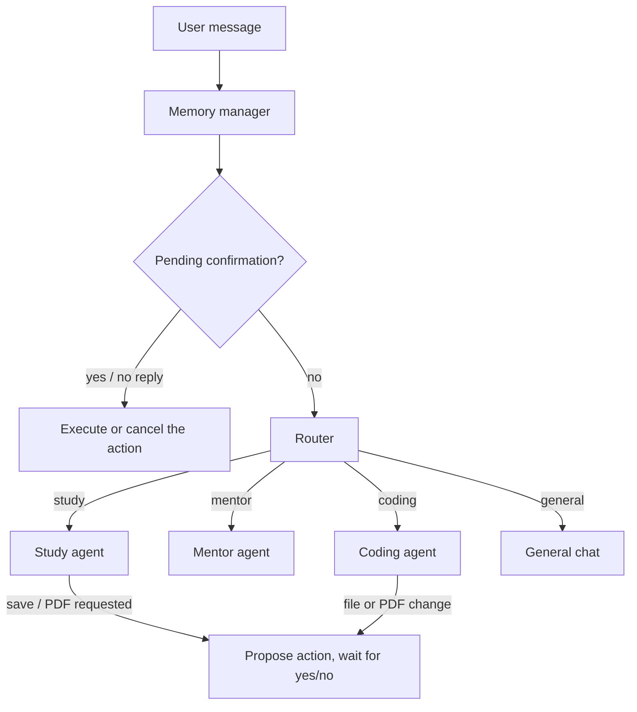
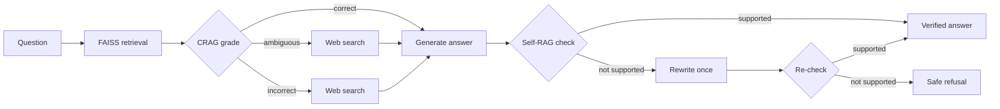

# TechMate

A multi-agent AI study and coding assistant built with **LangGraph** and **Streamlit**.

TechMate routes each request to a specialist agent (Study, Mentor, or Coding), answers study questions from your own uploaded material with hallucination checks, falls back to the web when your material doesn't cover a question, and asks for your explicit approval before it writes anything to disk.

<!-- Add a screenshot or short GIF here, e.g. docs/screenshots/chat.png -->

## Features

- **Supervisor routing.** Obvious requests are routed by rules (zero LLM calls); only ambiguous ones use one LLM routing call.
- **Study agent with grounded answers (RAG).** Uploaded PDF/TXT/MD files are indexed in FAISS. Answers cite file and page.
- **Corrective RAG (CRAG).** Each retrieved chunk is graded; only relevant chunks reach generation. The overall result is `correct`, `ambiguous`, or `incorrect`.
- **Web fallback.** On `ambiguous` or `incorrect`, TechMate searches the web (DuckDuckGo, no API key), labels the answer as web-sourced, and cites URLs.
- **Self-RAG verification.** Every answer is checked against the context it was written from. If it isn't supported, it is rewritten once, then rejected rather than shown.
- **PDF notes with confirmation.** Ask for "notes on X as a PDF". TechMate shows the answer, asks yes/no, and only then creates the file. "yes but make it shorter" revises the notes first. PDFs use numbered citations and a Sources list.
- **Human-in-the-loop (HITL).** File edits, flashcards, notes, and PDF operations (create, merge, split, watermark, annotate, fill form) are proposed first and executed only after you confirm.
- **Mentor agent.** Read-only programming help (explanations, debugging, code review) with per-user weak-area tracking.
- **Coding agent.** Creates and edits project files and runs tests, behind the confirmation step.
- **Provider resilience.** OpenRouter (free models) with automatic fallback to Gemini, plus a circuit breaker that skips a provider whose daily quota is exhausted.
- **Long-term memory.** PostgreSQL-backed LangGraph checkpoints, automatic conversation summarization, and a manual "Force Compress Memory" button.
- **Privacy.** Sensitive values (keys, secrets) are redacted from responses.

## Architecture



### Study pipeline



## Tech stack

Python 3.11 · LangGraph · LangChain · Streamlit · FAISS · sentence embeddings (Hugging Face) · PostgreSQL (Neon) · PyMuPDF · OpenRouter · Google Gemini · DuckDuckGo search (`ddgs`) · pytest

## Getting started

### Prerequisites

- Python 3.11
- A PostgreSQL database. A free [Neon](https://neon.tech) project works well (any PostgreSQL will do)
- A free [OpenRouter](https://openrouter.ai) API key and a [Gemini](https://aistudio.google.com/apikey) API key

### Setup

```bash
git clone https://github.com/laibaparvaiz/TechMate
cd TechMate

python -m venv myenv
# Windows:
myenv\Scripts\activate
# macOS / Linux:
# source myenv/bin/activate

pip install -r requirements.txt

cp .env.example .env        # Windows: copy .env.example .env
# edit .env: add your API keys and your PostgreSQL connection string

python -m streamlit run app/ui/streaming.py
```

**Database (Neon):** create a free project at [neon.tech](https://neon.tech), copy its connection string, and put it in `DATABASE_URL` in your `.env`. Use the full string from Neon's **Connect** dialog exactly as shown. It already includes the required `sslmode` and `channel_binding` parameters. TechMate creates its tables on startup. Free Neon databases suspend when idle, so the first request after a pause can be slow.

Then open http://localhost:8501, upload a PDF in the sidebar, and start asking questions.

### Configuration

| Variable | Purpose |
|---|---|
| `OPENROUTER_API_KEY` | Primary LLM provider (free models) |
| `GEMINI_API_KEY` | Fallback LLM provider (the model name is set in `app/config.py`) |
| `DATABASE_URL` | PostgreSQL connection string (for example from Neon) |
| `POSTGRES_USER`, `POSTGRES_PASSWORD`, `POSTGRES_HOST`, `POSTGRES_PORT`, `POSTGRES_DB` | Optional alternative to `DATABASE_URL` for a local PostgreSQL |

## Example prompts

| You type | What happens |
|---|---|
| `According to the uploaded PDF, what is the Build-Measure-Learn loop?` | Answer from your PDF, with file and page citations |
| `Explain FastAPI and make notes as a PDF` | Web fallback if not in your files, then asks yes/no before creating the PDF |
| `yes but make it shorter` | Rewrites the pending notes, then asks again |
| `make pdf of this` | Offers to save the previous answer as a PDF (no new AI call) |
| `Make flashcards on the Build-Measure-Learn loop` | Drafts flashcards, saves them after you confirm |
| `Debug this: x=[1,2]; print(x[5])` | Mentor explains the error |
| `Create a file hello.py that prints hi` | Coding agent previews the change and waits for confirmation |
| `Add a watermark DRAFT to Chapter 10.pdf, save as draft.pdf` | Proposes the watermark, applies it after you confirm |

## Tests

```bash
pip install -r requirements-dev.txt
pytest -q
```

The suite runs fully offline: no API calls, no network, no files written. LLM calls are replaced with fakes. It includes regression tests for bugs found during development and manual testing (routing, confirmation handling, CRAG grading, fallback behavior, citation and PDF formatting).

## Project structure

```
app/
  agents/      supervisor (routing, HITL), study / mentor / coding agents, summarizer
  database/    SQLAlchemy models
  memory/      LangGraph checkpointer, skill tracking
  prompts/     system prompts
  rag/         ingestion and retrieval (FAISS)
  safety/      HITL registry, permissions, privacy redaction, limits
  tools/       code, study, system tools and web search
  ui/          Streamlit app
  utils/       LLM router with fallback, context budgeting
tests/         pytest suite
data/          runtime data (ignored by git)
```

## Notes and limitations

- **Free-tier quotas.** Both free providers have daily limits. One question uses about 3 to 5 LLM calls (CRAG, generation, Self-RAG, and a retry when needed). When both are exhausted, TechMate says so instead of failing silently. Adding credits to OpenRouter raises its free-model daily limit.
- **Web answers are checked against the search snippets**, not against the truth of those pages. They are labeled as web-sourced for that reason.
- **Your documents stay local.** Uploads and the FAISS index live under `data/` and are not committed. Do not commit copyrighted material.
- **Harmless console noise.** You may see `[ERROR] ... is part of ...ImageProcessorKwargs, but not documented` lines at startup. They come from the installed `transformers` package, not from TechMate, and don't affect behavior.

## License

MIT. See [LICENSE](LICENSE).